<div align="center">
  
</div>

<h1 align="center">Tennis Network Analysis</h1>

<p align="center">
  <a href="https://github.com/FrancescoCastaldi/tennis-network-analysis/actions/workflows/ci.yml"></a>
  
  
</p>

<p align="center">
  Structural analysis of professional tennis match networks: historical eras, playing surfaces and the
  men's (ATP) and women's (WTA) tours.<br />
  Group project for the Network Analysis course, Master's Degree in Computer Science, University of Bologna, A.Y. 2026/2027.
</p>

> **Research question.** How does the structure of professional tennis match networks differ across
> eras, surfaces and tours, and what do these differences reveal about competitive balance and
> dominance in the sport?

## Contents

- [At a glance](#at-a-glance)
- [The model](#the-model)
- [Results](#results)
- [Quick start](#quick-start)
- [Repository layout](#repository-layout)
- [Documentation](#documentation)
- [Report](#report)
- [Group and authorship](#group-and-authorship)
- [Releases and citation](#releases-and-citation)
- [Contributing](#contributing)
- [License](#license)

## At a glance

| | |
|---|---|
| **Networks** | 13: 4 reference networks (Michieli, 2018) and 9 comparative networks built from 114,084 played matches (68,972 ATP, 45,112 WTA) |
| **Hypotheses** | 8 tested: 6 supported, 1 not supported (H1), 1 rejected in the opposite direction (H2) |
| **Reproducibility** | one seed (`20261115`), 195 tests, CI on every push, every table and figure generated from `results/` |
| **Report** | `report/main.tex`, 4,312 words by the repository count and 4,763 counting captions and references, against a limit of 5,000 |
| **Deadline** | 27 November 2026, 23:59 (course exam session) |
| **Version** | 0.2.7, see the [changelog](CHANGELOG.md) |

## The model

A **node** is a player. A **directed edge** goes from the loser to the winner of at least one official
main-draw singles match, **weighted** by the number of wins in the period. PageRank on this graph
rewards wins against players who themselves win often.

| Source | Networks | Use |
|---|---|---|
| [Michieli (2018)](https://arxiv.org/abs/1804.08138) | M1 wins, M2 points, M3 undirected, M4 extended (1968 to 2017/18, no dates) | Historical baseline and reproduction of the paper |
| [tennis-data.co.uk](http://www.tennis-data.co.uk/) | 4 ATP eras (2000 to 2025), 3 ATP surfaces, ATP and WTA 2007 to 2025 | Comparative study, hypotheses H1 to H8 |

## Results

Hypotheses, tested on the nine comparative networks:

| Hypothesis | Test | Outcome |
|---|---|---|
| **H1** prestige more concentrated in 2007-2018 (Big Three) than in 2019-2025 | season permutation | not supported (top-10 PageRank share 0.265 against 0.234, p = 0.060) |
| **H2** networks more disassortative than the configuration model | 200 degree-preserving nulls | rejected in the opposite direction: observed assortativity is higher than the null in all nine networks (z = 16 to 35) |
| **H3** grass is smaller and more centralized than clay and hard | match permutation, size-corrected | supported (p = 0.005 to 0.015) |
| **H4** WTA prestige less concentrated than ATP | paired sign-flip over seasons | supported for PageRank (p = 0.016), not for centralization (p = 0.17) |
| **H5** more rigid hierarchy (fewer cyclic triads) in 2007-2012 | season permutation of the 030C/030T ratio | supported (0.184 against 0.211, p = 0.010) |
| **H6** monadic: PageRank explains the ranking beyond wins | permutation regression | supported (p = 0.001 in every era; wins add nothing) |
| **H7** dyadic: head-to-head dominance carries over between surfaces | QAP | supported (r = 0.12 to 0.15, p = 0.001) |
| **H8** mixed: players with the same surface profile meet more often | QAP | supported (r = 0.06, p = 0.001) |

**Structure of the networks**

- All nine are sparse but compact: 62% to 70% of the players are in the giant strongly connected
  component, and two players are 2.4 to 3.3 wins apart on average.
- None is scale-free: bracket sizes and calendars cap how many opponents a player can meet.
- A dense core of 16% to 20% of the players, almost all in the official top 100, holds most of the
  matches. The rich-club coefficient shows elite closure in every network (peak 1.05 to 1.22, z = 13 to 27).

**Validity of the data**

- The pipeline reproduces the figures of Michieli (2018) on M1, M3 and M4. One exception: the average
  clustering of M3 is 0.311 here against 0.07 in the paper, and no standard definition gives the published value.
- tennis-data.co.uk and Michieli agree on 97.6% of the loser-winner pairs and 99.3% of the players over
  their common window (January 2000 to August 2017).
- Sensitivity to the cleaning choices: every H3 and H4 verdict holds at the 5% level. H1 is borderline
  (p = 0.036 without retirements, 0.053 with walkovers, 0.060 in the report).

Every number above is in the committed tables: [`hypothesis_tests.csv`](results/tables/hypothesis_tests.csv),
[`triads_h5.csv`](results/tables/triads_h5.csv), [`levels_tests.csv`](results/tables/levels_tests.csv),
[`rich_club_summary.csv`](results/tables/rich_club_summary.csv),
[`michieli_reproduction.csv`](results/tables/michieli_reproduction.csv),
[`td_validity_michieli.csv`](results/tables/td_validity_michieli.csv) and
[`sensitivity_tests.csv`](results/tables/sensitivity_tests.csv).

## Quick start

```bash
python -m venv .venv
source .venv/bin/activate          # Windows: .venv\Scripts\activate
pip install -e ".[dev]"
pytest
```

The processed networks, the results and the generated report assets are committed, so the report
can be rebuilt without running the analysis.

**Notebook.** [`notebooks/full_pipeline.ipynb`](notebooks/full_pipeline.ipynb) runs the pipeline in order
and shows the main tables and figures after each step. Install the notebook extras with
`pip install -e ".[dev,notebook]"`, open the notebook on the `.venv` kernel and choose *Run All*.
Set `QUICK = True` for a short demonstration run. Use `QUICK = False` to reproduce the report.

**Full pipeline from the raw files.** Run `make all`, or the commands below one by one.

| Step | Command | Writes |
|---|---|---|
| Download tennis-data.co.uk (optional, files are committed) | `python -m tennis_networks.download` | `data/raw/tennisdata/` |
| Convert the Michieli networks | `python -m tennis_networks.michieli` | `data/processed/michieli_*.csv` |
| Build the comparative networks | `python -m tennis_networks.tennisdata` | `data/processed/td_*.csv` |
| Reproduce the paper | `python -m tennis_networks.reproduce` | `results/tables/michieli_reproduction.csv` |
| Measures and null models | `python -m tennis_networks.analysis` | `results/` |
| Hypotheses H1 to H4 | `python -m tennis_networks.hypotheses` | `results/tables/hypothesis_tests.csv` |
| Agreement with Michieli | `python -m tennis_networks.source_check` | `results/tables/td_michieli_*.csv` |
| Sensitivity of H1, H3, H4 | `python -m tennis_networks.sensitivity` | `results/tables/sensitivity_*.csv` |
| HITS, equivalence, core-periphery, small-world | `python -m tennis_networks.structure` | `results/tables/structure_summary.csv` |
| Triad census and H5 | `python -m tennis_networks.triads` | `results/tables/triads_*.csv` |
| Rich-club and elite closure | `python -m tennis_networks.rich_club` | `results/tables/rich_club_summary.csv` |
| Degree fits, compactness, ranking-band homophily | `python -m tennis_networks.topology` | `results/tables/powerlaw_fits.csv` and related |
| Hypotheses H6 to H8 | `python -m tennis_networks.levels` | `results/tables/levels_tests.csv` |
| Report tables and figures | `python -m tennis_networks.report_assets` | `report/tables/`, `report/figures/` |
| Word limit | `python -m tennis_networks.wordcount` | exit code 1 above 5,000 words |

All random draws use the seed in [`config/networks.json`](config/networks.json) (`20261115`). Most of
the running time goes into the null models. `--samples` on the analysis stage sets the number of null
graphs. `python -m tennis_networks.analysis --centralization-only` refreshes the degree centralization
column in an existing global table without rerunning null models. `python run_analysis.py --quick` runs a
short check on selected networks. Analysis runs also write `results/run_manifest.json`, which records the
configuration hash, the environment, the Git commit and SHA-256 fingerprints of the processed inputs.
Hypothesis tables keep the raw permutation p-values and add Holm-adjusted values in `p_value_holm`.

## Repository layout

```text
config/networks.json     networks of the study, seed and null-model sizes
data/raw/                original files, never edited (provenance in docs/data.md)
data/processed/          edge lists (source, target, weight) and rank tables
src/tennis_networks/     the Python package, one module per pipeline step
notebooks/               the full pipeline as a notebook, outputs rendered
scripts/                 checks used by the pull request workflows and the sheet sync
tests/                   unit tests and data checks (pytest)
results/                 committed tables (CSV), figures and null distributions
report/                  LaTeX report: main.tex, generated tables and figures, submission PDF
docs/                    data provenance, methodology, architecture and design decisions
.github/                 CI workflows, pull request template, issue templates
CHANGELOG.md             changes by version (Keep a Changelog)
CITATION.cff             how to cite the work
```

## Documentation

| Document | What it covers |
|---|---|
| [Architecture](docs/architecture.md) | Where each stage reads and writes, configuration boundaries, safe reruns |
| [Python API](docs/API.md) | Reusable functions, parameters, return values and examples |
| [Methodology](docs/methodology.md) | Formal definitions of the measures, null models and tests |
| [Data](docs/data.md) | Provenance, download protocol, SHA-256 digests, cross-source checks |
| [Decisions](docs/decisions.md) | Architecture decision records |
| [Tests](tests/README.md) | What each test file checks and which side effects to watch for |

## Report

[`report/main.tex`](report/main.tex) follows the official course template: A4, single column, 12 pt Times,
3 cm margins, at most 5,000 words. The report has 11 tables and 7 figures, all generated by
`make report-assets`. Never edit `report/tables/` or `report/figures/` by hand. CI builds the PDF on every
push and attaches it to the run as an artifact. The submission PDF is in
[`report/submission/`](report/submission/).

## Group and authorship

| Area | Weight | Lead | Report sections | Status |
|---|---|---|---|---|
| Context and problem | 20% | Shivam Kumar (Role A) | Introduction, Problem and Motivation | Written |
| Datasets and validity | 60% | Francesco Castaldi (Role B1) | Datasets, Validity and Reliability | Written |
| Measures | 60% | Jacopo Bonifazi (Role B2) | Measures and Results (measures) | Written, in subsections |
| Hypotheses and tests | 60% | Gaetano Muscarello (Role B3) | Measures and Results (hypotheses) | Written, H1 to H8 with verdicts |
| Interpretation and critique | 20% | Paolo Fusco (Role C) | Conclusion, Critique | Written, to be checked against the research questions |

The report is at 4,312 words by the repository count and 4,763 counting captions and references, so any addition needs an offsetting cut.

## Releases and citation

Each release is an annotated tag `vX.Y.Z` on `main`, with a page under Releases that lists the changes, the
report PDF compiled at that tag, the pipeline results and a `SHA256SUMS.txt` to check the downloads. The
process is described in [CONTRIBUTING.md](CONTRIBUTING.md#releases) and driven by `scripts/release.py`.
To cite the work, use [`CITATION.cff`](CITATION.cff).

## Contributing

See [CONTRIBUTING.md](CONTRIBUTING.md) for roles, branches, commits and the review checklist. Work is
tracked in the private [SNA Tennis project](https://github.com/users/FrancescoCastaldi/projects/3).

## License

Code under the [MIT License](LICENSE). The datasets belong to their authors, see [docs/data.md](docs/data.md).

Jacopo Bonifazi, Francesco Castaldi, Paolo Fusco, Shivam Kumar and Gaetano Muscarello.
